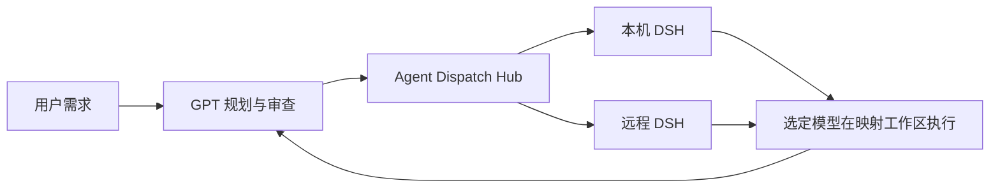

# Agent Dispatch Hub

让 GPT 与 DSH 按项目协作：GPT 可以派工并审查，DSH 也可以从普通会话主动向专属 Codex 顾问求助。Agent Dispatch Hub 把派工、消息和调度包装为可安装、可配置的 CLI 与 MCP 工具：同事拿到仓库链接后，可以交给自己的 AI 完成环境检查、配置和验收。

它通过命名目标连接本机或远程执行环境，分别配置实例身份、DSH 工作区归属、任务执行目录、源码目录和读写范围。回执保存这些信息；切换默认目标不会改投已有任务。配置与目录不一致时明确报错。



v0.4.0 保留 DSH 派工执行端，增加独立消息与专属 Codex 顾问。这不是 Codex 原生子代理：DSH 执行模型的登录、权限和费用由 DSH 管理；顾问使用所选 Codex CLI 自身的登录和用量，不要求另设 API Key。

新增 [任务内提问与回答](docs/README-QUESTIONS.md)：DSH 遇到关键歧义时返回 `needs_input`，Codex 通过 `hub_answer` 回答，同一会话继续执行。问题和答案可恢复、可核对，重复回答不会重复派发。该回复协议兼容已有 placement 目标，无需为它更新 DSH 插件。

如果是你自己在 DSH 打开的普通会话，也能通过 [独立消息通道](docs/README-MESSAGING.md) 主动向项目 Codex 顾问求助。收件箱先保存，调度器再处理，建议回到原会话；专属顾问不占用用户正在进行的桌面主对话。该模式按需启用独立消息插件和本地服务，普通派工不自动启用。

旧配置升级先读 [工作区与迁移说明](docs/README-PLACEMENT.md)。工作区归组与文件权限分别处理；当前读写范围作为明确的任务指令，不声称任意目录的沙箱强制隔离。

## 开始使用

需要 Node.js 22 或更新版本、Git，以及允许使用的 DSH 环境。第一次安装建议直接让 AI 阅读 [README-AI.md](README-AI.md)，按其中步骤检查和配置；该文件也提供可复制的交接提示。

已经完成配置时，在仓库目录运行：

```sh
node bin/adh.mjs doctor
node bin/adh.mjs target list
node bin/adh.mjs status --target office
node bin/adh.mjs dispatch --target office --workspace demo --text "检查当前项目并说明下一步建议，先不要修改文件。"
```

`office` 和 `demo` 是示例名称，使用配置中真实存在的目标和工作区别名。

## 按你的任务阅读

| 读者与目的 | 文档 |
| --- | --- |
| 想判断是否适合自己的工作方式 | [产品说明](docs/README-PRODUCT.md) |
| 交给 AI 安装、接入和验收 | [AI 安装交接](README-AI.md) |
| 配置本机、远程目标或处理配对 | [连接与配置](docs/README-CONNECTIONS.md) |
| 设置归属、独立任务目录及迁移旧配置 | [工作区与迁移](docs/README-PLACEMENT.md) |
| 执行者提问、负责人回答及继续原任务 | [任务内提问](docs/README-QUESTIONS.md) |
| 普通 DSH 会话主动求助、顾问处理和回复 | [独立消息与调度](docs/README-MESSAGING.md) |
| 维护成员、收件箱、调度器及执行端 | [消息工程结构](docs/MESSAGING-DESIGN.md) |
| 修改代码、增加后端适配器 | [开发说明](docs/README-DEVELOPMENT.md) |
| 安装失败、连接失败、任务异常 | [故障排查](docs/README-TROUBLESHOOTING.md) |
| 查看依赖来源和许可边界 | [第三方说明](docs/THIRD-PARTY.md) |

v0.2 已在选定的 Windows 本机 DSH rc.3 完成真实归组、独立 cwd、模型产物及 MCP 入口验证。远程真实实例尚未验收，协议与跨系统路径使用模拟测试；详情见 [验证记录](docs/VALIDATION-V0.2.md)。
