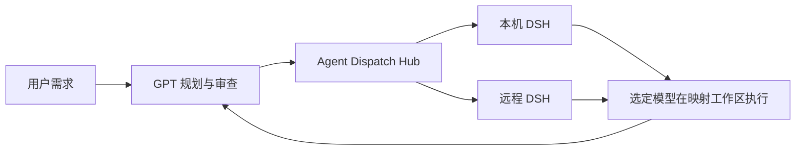

# Agent Dispatch Hub

让 GPT 负责理解需求、拆任务和审查结果，让 DSH 中选定的模型负责执行。Agent Dispatch Hub 把这条协作链包装为可安装、可配置的 CLI 与 MCP 工具：同事拿到仓库链接后，可以交给自己的 AI 完成环境检查、配置和验收。

它通过显式命名的目标连接本机或远程执行环境，每个目标分别配置可用工作区。任务回执记录实际目标和工作区，之后切换默认目标也不会把已有任务发到另一台机器。



v0.1.0 只包含 DSH 适配器。这不是 Codex 原生子代理，也不会自动复用 Codex 模型额度或密钥；执行模型及其登录、权限和费用由 DSH 环境管理。后续后端可通过适配器接口扩展。

## 开始使用

需要 Node.js 22 或更新版本、Git，以及允许使用的 DSH 环境。第一次安装建议直接让 AI 阅读 [README-AI.md](README-AI.md)，按其中步骤检查和配置；该文件也提供可复制的交接提示。

已经完成配置时，在仓库目录运行：

```sh
node bin/adh.mjs doctor
node bin/adh.mjs target list
node bin/adh.mjs status --target office
node bin/adh.mjs dispatch --target office --workspace demo --text "检查当前项目并说明下一步建议，先不要修改文件。"
```

`office` 和 `demo` 是示例名称，使用配置中真实存在的目标和工作区别名。

## 按你的任务阅读

| 读者与目的 | 文档 |
| --- | --- |
| 想判断是否适合自己的工作方式 | [产品说明](docs/README-PRODUCT.md) |
| 交给 AI 安装、接入和验收 | [AI 安装交接](README-AI.md) |
| 配置本机、远程目标或处理配对 | [连接与配置](docs/README-CONNECTIONS.md) |
| 修改代码、增加后端适配器 | [开发说明](docs/README-DEVELOPMENT.md) |
| 安装失败、连接失败、任务异常 | [故障排查](docs/README-TROUBLESHOOTING.md) |
| 查看依赖来源和许可边界 | [第三方说明](docs/THIRD-PARTY.md) |

原始协作链已在本地 DSH rc3 / Qwen3.8 环境做过验证；新产品 v0.1.0 的安装、路由和真实模型验收状态应以发布前记录为准，原型验证不能代替本仓库的验收。
