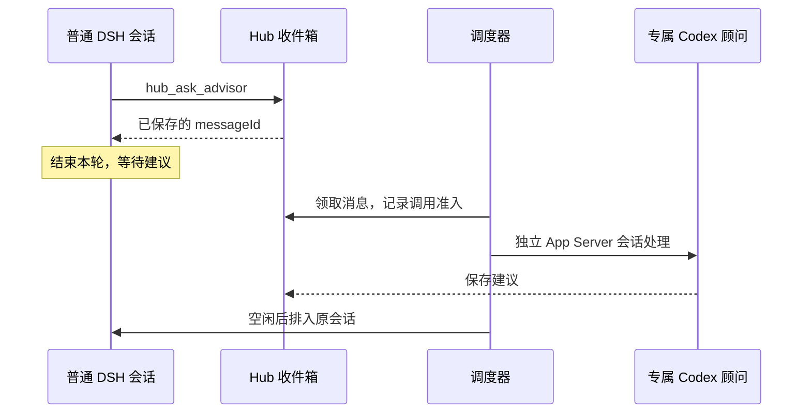

# 从普通 DSH 会话主动向 Codex 顾问求助

v0.4 新增独立消息通道。DSH 会话不必先由 Hub 派发，就能向项目里的专属 Codex 顾问提出问题；消息先进入持久收件箱，调度器再启动顾问处理，建议最后送回原来的 DSH 会话。原来的 `hub_dispatch` 和任务内 `hub_answer` 继续保留。

这一版实现一对项目成员：一个 DSH 工作区成员和一个专属 Codex 顾问。可配置多个项目，每个项目有独立身份、实例绑定和预算。它还不是多人群聊、任意桌面会话互发消息或共享源码并发编辑工具。



## 接入步骤

需要现有 Hub 命名目标与 placement 映射、Node.js 22+、带 npm 的 Node 运行时，以及可运行并已登录的 Codex CLI。顾问使用 CLI 创建的专属 App Server 会话，不驱动用户当前桌面聊天，也不需要另配 OpenAI API Key。默认使用 CLI 私有登录凭据；仅通过任意环境变量提供的 API 凭据不会自动传给顾问子进程。

先让 AI 根据 [团队配置示例](../examples/team-config.example.json) 填写真实值。三个目录概念要分开：`project.root` 是顾问所在控制机的本地项目目录；`dsh.workspace` 是已有目标的映射别名；`dsh.sessionRoots` 是 DSH 机器上允许发起求助的会话目录范围。远程 DSH 的目录不能当成本机目录解析。

```sh
node bin/adh.mjs team configure --file <absolute-team-config.json>
node bin/adh.mjs team members
node bin/adh.mjs team serve --port 0
```

`configure` 会核对选定目标的实例与工作区，保存绑定，不改变默认目标、模型或旧任务。成员 ID 在同一状态目录唯一。项目路由绑定不可原地改投，需换实例或项目时使用新的项目/成员 ID；已有消息仍指向原实例。启停及预算可以明确调整。

`serve` 是需要持续运行的本地进程，默认仅监听 `127.0.0.1`，不会自动开机启动。它发布受保护的成员连接文件，输出只有文件路径、成员名和无认证参数的监听地址。另开终端，为选定的本机 DSH profile 安装独立消息插件：

```sh
node bin/adh.mjs team install-dsh --member <dsh-member-id> --profile-directory <selected-local-DSH-profile>
```

安装使用 DSH 公开插件管理接口，新包名为 `agent-dispatch-hub-messaging`。不替换运行中的旧插件；如果原生管理器要求重启或已有包无法加载，明确报错，按 DSH 正常生命周期处理。插件只增加两个消息工具，保留现有模型和权限设置。安装目录中的目录册指向 Hub 的受保护连接文件，因此本机服务重启、端口重新分配后，下一次工具调用会读取新地址。

## 在 DSH 里使用

在已有 DSH 会话中，可以直接说：

> 请通过 hub_ask_advisor 向项目顾问询问这个设计问题，附上目标、相关文件名和已尝试的方法。提交后结束本轮，等顾问回复。

`hub_ask_advisor` 自动读取真正调用工具的会话 ID，不接受模型伪造的来源会话。一个 profile 配了多个项目时，明确传 `project`；只有一个时可省略。提问工具支持 `question`、`context`、项目相对 `files` 和可选的稳定 `requestId`。重试必须复用同一 requestId；不提供时使用本次原生工具 callId。

本机 Windows 配置使用实际 `codex.exe`，不把 `.cmd` / `.ps1` 启动脚本当作原生可执行程序。自定义 DSH preset 若屏蔽了消息工具，需要在该 preset 中显式启用；插件不会绕过 preset 的工具限制。

`hub_advisor_message` 可读取原消息，但不要让模型循环轮询。消息已经落盘和模型已经开始处理是两件事；服务运行而顾问暂未启动时可以排队。Hub 服务本身不可达时不会宣称已送达，应保留原 requestId，恢复连接后重试。

建议通过原会话的排队接口返回：DSH 正忙、已有待处理输入或有人类问题待答时，调度器延后投递。`delivered` 只表示原会话已确认接收入队，不表示 DSH 已执行完后续动作。建议明确标注来自 AI，不能作为人类批准；`needsHuman:true` 时先询问用户，不能自动扩大范围。

## 预算与断线恢复

默认每个项目最多 **20 次顾问模型准入尝试**，不是每日自动刷新额度，也不是积分或 token 硬上限。准入前持久计数；响应丢失和已拒绝的尝试保守计入，不自动返还。每条消息只触发一次顾问处理和一次原会话回复，不自动生成下一轮问题。调度、读取收件箱和核对旧请求不调用模型；顾问处理和 DSH 收到回复后继续工作仍消耗各自用量。

```sh
node bin/adh.mjs team receipt --message <message-id>
node bin/adh.mjs team recover --message <message-id>
node bin/adh.mjs team disable --project <project-id>
node bin/adh.mjs team budget --project <project-id> --max-calls 30
```

`recover` 按原线程、轮次或回复请求读取证据，不重发不确定的模型请求或 DSH 回复。已明确拒绝、未开始推理的准备失败，可由负责人显式恢复后重新排队。进程在领取消息后退出，仅在显式恢复、阶段证明尚未开始外部调用且原控制机 PID 确已退出时，才能释放该成员槽位；不按时间自动过期。线程创建回执丢失、未知准入或遗留状态事务锁仍需管理员检查，不能猜测未执行后直接重发。

调高预算是本机负责人操作，会恢复尚未启动的预算阻塞消息，保留已用次数；成员 HTTP 凭据不能修改预算、配置或启停。禁用项目阻止新的模型准入与回信，不强行停止已在处理的模型。模型超时保留不确定状态，不能把超时当作未计费或已停止。

## 权限、远程与限制

顾问按本次专属线程实际模型记录回执，不修改主会话或全局模型。其配置禁用继承的 MCP、应用、插件、Shell、图片读取和子代理，并要求原生返回只读沙箱、工具网络关闭及禁止交互批准；不满足则不启动模型。输入是数据，不是新授权。子进程不继承任意环境密钥；检测到已知成员凭据或明显密钥形态时阻止回信。

这不是针对同一 OS 账号下恶意插件/管理员的安全隔离，也不是完整的秘密检测。所验 CLI 版本不支持任意只读根的原生约束，不宣称单靠工作区或只读沙箱能限制全部读取；顾问通过明确提供的上下文给建议，不承担自由读取任意项目、执行修改的职责。

远程 DSH 使用同样的目标、工作区和会话绑定协议，但本机 `install-dsh` 不把本地 tarball 路径发给远程服务器。远程管理员需在目标机安装消息包，将受保护的成员连接文件放在目标机，并通过自己配置的 HTTPS 反向代理连接 Hub；连接文件必须使用该 HTTPS origin。Hub 不自动开放公网监听、忽略 TLS 或尝试其他实例。未授权远程实例仅做模拟测试。

状态在仓库外的 `team/state.json`，当前上限为 5 MiB / 1000 条消息，使用短事务锁和原子替换；不自动删除历史。大规模多人协作应替换存储后端并增加归档能力。更多实现和实际范围见 [结构说明](MESSAGING-DESIGN.md) 与 [验收记录](VALIDATION-MESSAGING.md)。
