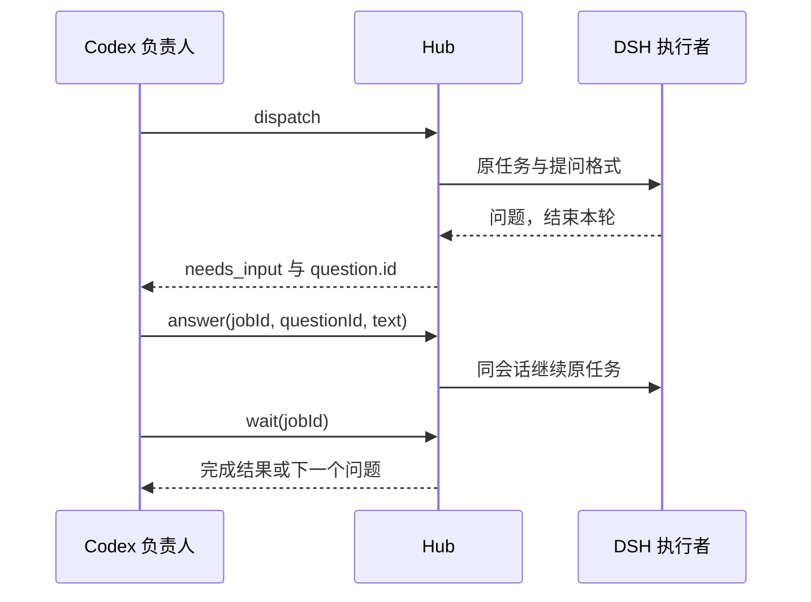

# DSH 遇到问题时向负责人提问

执行任务时，DSH 可能遇到会改变业务方向、范围或兼容性的歧义。新任务可以返回一个明确的问题，Hub 保存为“等待决策”，Codex 根据已有授权回答，再让同一 DSH 会话继续。普通实现细节仍由执行者自行判断。



## Codex 怎样处理

`hub_dispatch` 或 `hub_wait` 返回 `status:"needs_input"`、`completed:false`、`turnCompleted:true` 和 `question` 时，表示执行者已经结束这一轮，整个任务尚未完成。问题包含稳定的 `id`、原 `requestId`、问题正文及可选的背景、选项和建议。

先判断能否在已有授权内回答。实现选择可由 Codex 决定；改变业务方向、扩大权限或需要人提供信息时，应向用户确认。DSH 的建议不是授权。

用 `hub_answer({jobId,questionId,text})` 回答，再调用 `hub_wait({jobId})`。`hub_answer` 只确认回答的提交，不会等待模型执行完成。`hub_questions({jobId})` 读取已经保存的问题和回答记录，不联系模型；发现新问题仍需调用 `hub_wait`。

CLI 使用同一流程，下面的名称和 ID 均为占位值：

MCP 派工参数见 [任务示例](../examples/question-task.example.json)，替换其中占位值后可交给 `scripts/call-tool.mjs hub_dispatch` 使用。

```sh
node bin/adh.mjs dispatch --target <target> --workspace <mapping> --text-file <task.txt> --max-questions 5
node bin/adh.mjs wait --job <job-id>
node bin/adh.mjs questions --job <job-id>
node bin/adh.mjs answer --job <job-id> --question-id <question-id> --text-file <decision.txt>
node bin/adh.mjs wait --job <job-id>
```

有待回答的问题时，普通 `send` 会拒绝跳过它。默认每个新任务最多接受 5 次提问；派工时可设置 `maxQuestions`（CLI 为 `--max-questions`）为 0–10，0 关闭协议。达到上限返回 `question_limit_reached`，不会自动回答或循环派工；负责人应检查任务，必要时明确取消并重新拆分。

## 协议怎样传递

这是任务回复协议，不安装额外的模型提供方或新 DSH 工具。Hub 把本次请求 ID 和格式加进任务指令，DSH 在关键歧义时停止工具调用及修改，发送唯一最终回复：

```json
{"adhQuestion":1,"requestId":"<current-request-id>","question":"需要确认的问题","context":"必要发现","options":["方案 A","方案 B"],"recommendation":"建议及理由"}
```

也接受唯一的 `adh-question` 代码围栏。只有当前请求提交之后、对应完成事件之前的最终 assistant 消息才参与识别。普通文字、工具输出、旧请求和说明文字中的示例不会被当成提问。不支持 DSH 原生 `ask_user_question` 的自动转接，执行者应遵循 Hub 给出的格式。

`question` 必填且最多 2000 个 Unicode 字符；`context` 最多 6000；`options` 可省略，提供时须为 2–5 个非空字符串，每个最多 500；`recommendation` 最多 1000。协议文本最多 64 KiB，不接受其他字段。格式或请求标识错误返回 `question_error`，并保留原始结果供排查。负责人回答最多 12000 个 JavaScript 字符单元。

## 断线、重启和安全执行

问题与答案保存在仓库外的原任务回执中，绑定原任务、请求和会话。控制器重启或反复等待不会生成第二个问题。相同问题、相同答案重复提交只返回原提交记录；不同答案报 `answer-conflict`。网络中断后，重复 `answer` 只核对原请求是否已进入历史或队列，不再次发送；尚未确认时继续等待或检查回执。

切换默认目标不会改变回答的去向。原连接、实例、映射或目录改变时明确拒绝，不改投其他实例。回答仍包含原目录与读写范围约束，不改变模型，也不能把只读会话升级成写入会话。取消后的任务不能通过回答恢复。

在支持 v0.3 安全运行的目标上，提问这一轮仍须完成原有审计和原生空闲核对，才可释放该轮源码租约。**等待决策期间不保证一直占有源码锁。** 回答会启动同一会话的新一轮，重新申请租约和采集基线；执行者必须重读受影响的文件。审计失败或原生任务尚未结束时，回答不能绕过锁。

## 安装与边界

使用支持此功能的 Hub 代码后，重新加载 Codex 的 Hub MCP，检查 `hub_questions`、`hub_answer` 和更新后的 `hub_wait`。旧对话尚未刷新工具列表时，可用 [AI 交接中的同 MCP 调用入口](../README-AI.md)；不必为提问协议重新安装 DSH 插件。

当前已安装的 placement v0.2 目标可使用此回复协议，但没有 v0.3 的只读强制限制、源码锁或文件快照。不要把提问验收当成安全运行验收。

已有回执不自动启用协议，不改变正在执行的任务。要使用此能力，显式派发新任务；新字段不要求迁移目标配置。

这一版在 Codex 主动派工或等待时返回问题。没有后台监听器、桌面通知或自动唤醒空闲 Codex 的功能；不会让两个模型自行无限对话。等待本身不发模型请求，但提问和回答后的继续执行仍按各自提供方计费。

自动测试与公司本机实际闭环见 [提问验收记录](VALIDATION-QUESTIONS.md)。
